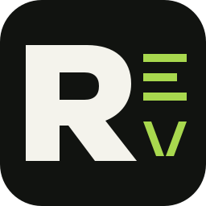

<div align="center">
  
  <h1>Model name</h1>
  <p><a href="README.ru.md">Русский</a> · <a href="https://huggingface.co/collections/ehristoforu/rev-llm-models">Hugging Face</a> · <a href="https://github.com/ehristoforu/rev-llm">GitHub</a></p>
</div>

One-sentence summary of the model and its intended strengths.


| Task | Result |
|---|---|
| Task name | **Improved** |

## Model recipe

```text
Base model
    │
    ▼
Fine-tuned model merge
    │
    ▼
Adapter merge or next recipe step
    │
    ▼
Model release
```

## Technical details

| Property | Value |
|---|---|
| Base model | [Name](upstream-model-card) |
| Architecture | architecture name |
| Model type | task type |
| Parameters | model size |
| Context length | base context length |
| Weights | [Model weights](model-link) |

Architecture and technical specifications are inherited from the base model without changes.

## Run with llama.cpp

Download and launch the published GGUF file directly from Hugging Face:

```bash
llama-server --hf-repo username/model-repo --hf-file model.Q4_K_M.gguf -c 8192
```

The server listens on `http://127.0.0.1:9931` by default. See the [llama.cpp server documentation](https://github.com/ggml-org/llama.cpp/blob/master/tools/server/README.md) for build instructions, GPU offload, Docker, and API usage.

## License

The base model's license is preserved: [License name](license-link).
