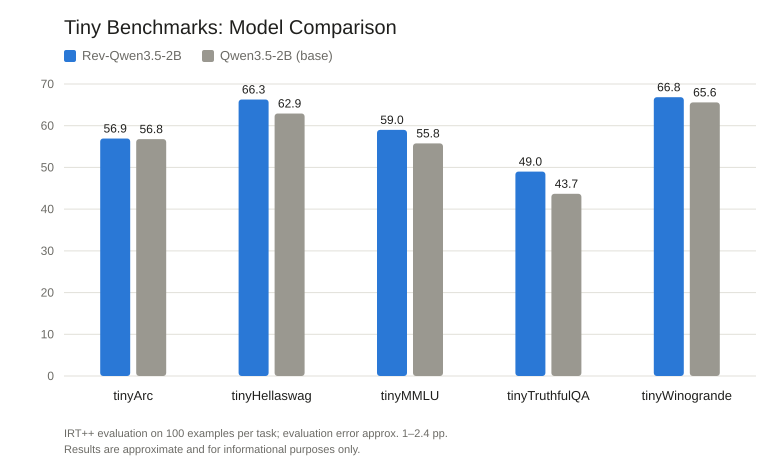

<div align="center">
  
  <h1>Rev-Qwen3.5-2B</h1>
  <p><a href="README.ru.md">Русский</a> · <a href="https://huggingface.co/collections/ehristoforu/rev-llm-models">Hugging Face</a> · <a href="https://github.com/ehristoforu/rev-llm">GitHub</a></p>
</div>

Rev-Qwen3.5-2B is a merge-based improvement of [Qwen/Qwen3.5-2B](https://huggingface.co/Qwen/Qwen3.5-2B), focused on communication, reasoning, science, coding, and agent tasks.



| Task | Result |
|---|---|
| Basic Communication | **Improved** |
| Translation | **Improved** |
| Mathematics | **Improved** |
| Physics | **Improved** |
| Biology | **Improved** |
| Medicine | **Improved** |
| Coding | **Improved** |
| Agent Functions | **Improved** |

## Model recipe

```text
Qwen/Qwen3.5-2B
        │
        ▼
Merge fine-tuned models
        │
        ▼
Merge LoRA trained on distillation from open-weight flagship models
        │
        ▼
Rev-Qwen3.5-2B
```

## Technical details

| Property | Value |
|---|---|
| Base model | [Qwen/Qwen3.5-2B](https://huggingface.co/Qwen/Qwen3.5-2B) |
| Architecture | qwen3_5 |
| Model type | image-text-to-text |
| Parameters | 2B |
| Context length | 262,144 tokens |
| Weights | [Hugging Face](https://huggingface.co/collections/ehristoforu/rev-llm-models) |

Architecture and technical specifications are inherited from the base model without changes.

## Run with llama.cpp

Download and launch the published GGUF file directly from Hugging Face:

```bash
llama-server --hf-repo ehristoforu/rev-qwen3.5-2b --hf-file Rev-Qwen3.5-2B-Q4_K_M.gguf -c 8192
```

The server listens on `http://127.0.0.1:9931` by default. See the [llama.cpp server documentation](https://github.com/ggml-org/llama.cpp/blob/master/tools/server/README.md) for build instructions, GPU offload, Docker, and API usage.

## License

The base model's license is preserved: [Apache-2.0](https://www.apache.org/licenses/LICENSE-2.0).
