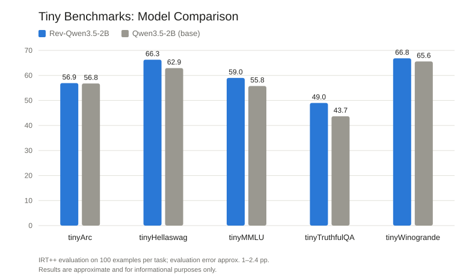

<div align="center">
  
  <h1>Rev-Qwen3.5-2B</h1>
  <p><a href="README.md">English</a> · <a href="https://huggingface.co/collections/ehristoforu/rev-llm-models">Hugging Face</a> · <a href="https://github.com/ehristoforu/rev-llm">GitHub</a></p>
</div>

Rev-Qwen3.5-2B — улучшенная модель на основе слияния [Qwen/Qwen3.5-2B](https://huggingface.co/Qwen/Qwen3.5-2B), с упором на общение, рассуждения, науки, программирование и агентные задачи.



| Задача | Результат |
|---|---|
| Базовое общение | **Улучшено** |
| Перевод | **Улучшено** |
| Математика | **Улучшено** |
| Физика | **Улучшено** |
| Биология | **Улучшено** |
| Медицина | **Улучшено** |
| Программирование | **Улучшено** |
| Агентные функции | **Улучшено** |

## Рецепт модели

```text
Qwen/Qwen3.5-2B
        │
        ▼
Слияние файнтюнов
        │
        ▼
Слияние LoRA, обученной на дистилляции флагманских моделей с открытыми весами
        │
        ▼
Rev-Qwen3.5-2B
```

## Технические сведения

| Параметр | Значение |
|---|---|
| Базовая модель | [Qwen/Qwen3.5-2B](https://huggingface.co/Qwen/Qwen3.5-2B) |
| Архитектура | qwen3_5 |
| Тип модели | image-text-to-text |
| Параметры | 2B |
| Контекст | 262 144 токена |
| Веса | [Hugging Face](https://huggingface.co/collections/ehristoforu/rev-llm-models) |

Архитектура и технические характеристики унаследованы от базовой модели без изменений.

## Запуск через llama.cpp

Скачайте и запустите опубликованный GGUF-файл напрямую с Hugging Face:

```bash
llama-server --hf-repo ehristoforu/rev-qwen3.5-2b --hf-file Rev-Qwen3.5-2B-Q4_K_M.gguf -c 8192
```

По умолчанию сервер доступен по адресу `http://127.0.0.1:9931`. Инструкции по сборке, GPU-offload, Docker и API — в [документации сервера llama.cpp](https://github.com/ggml-org/llama.cpp/blob/master/tools/server/README.md).

## Лицензия

Лицензия базовой модели сохраняется: [Apache-2.0](https://www.apache.org/licenses/LICENSE-2.0).
